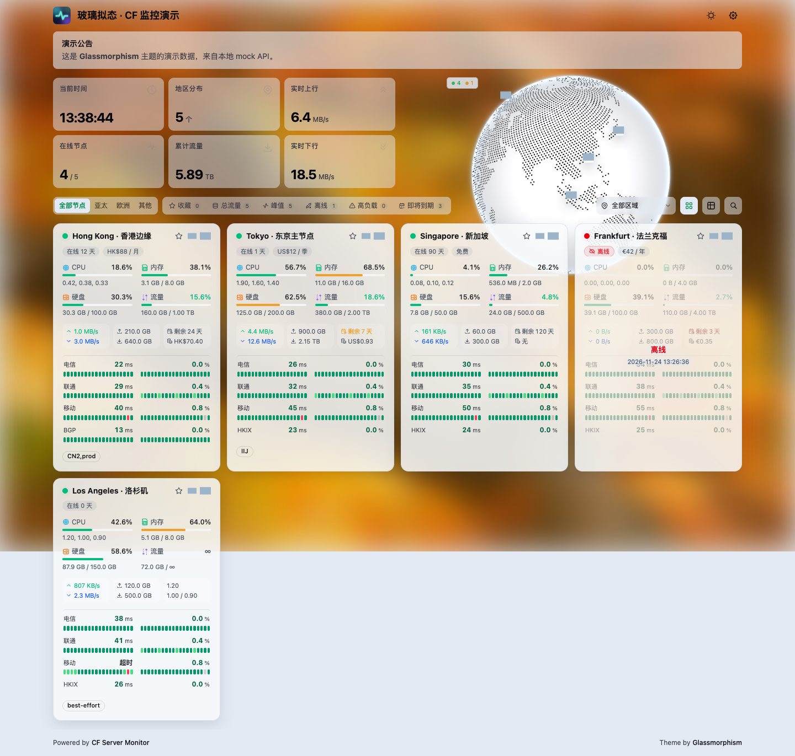

# Glassmorphism for CF-Server-Monitor

把 [Glassmorphism](https://github.com/Gongsc/Theme-Glassmorphism) 主题移植到 **CF-Server-Monitor**（Cloudflare Workers + D1 的服务器监控面板）。保留原主题的玻璃拟态视觉、地球视图、节点卡片与详情图表，数据层全部改用 CF-Server-Monitor 的公开接口。

> 上游主题最早移植自 Komari 主题，后适配「极简探针 Monitor」；本项目是它在 CF-Server-Monitor 上的第三站。



## 功能

- **玻璃拟态外观**：动态渐变背景、翡翠/柔和/高对比/午夜/自定义配色、浅色/深色/跟随系统，背景支持 Bing 每日壁纸、图片或视频。
- **地球与地图**：贴图地球、Cobe 点阵地球、平铺世界地图、点阵平铺地图；可标注国家与城市、自动旋转或隐藏。
- **首页概览**：可配置的概览卡片（当前时间、在线率、流量、实时速率、地区分布等）、Markdown 公告、分组标签、区域筛选、搜索、收藏、快捷筛选（离线、高负载、即将到期等）。
- **节点卡片**：mini / compact / comfortable / large 四种尺寸与列表视图；离线节点淡化并标注「离线」。
- **多线路延迟**：卡片显示 CT / CU / CM / BGP 及四条自定义节点线路的最新延迟与丢包。窗口小图只使用 `/api/servers` 返回的 `ping` / `loss` 数组，不额外拉历史。
- **节点详情**：`/#/server/:id`；负载图表（CPU、内存与 Swap、磁盘、网络、连接数、进程）、延迟与丢包图表（延迟/丢包切换、时间范围切换）、硬件与费用信息、费用明细。
- **主题设置**：管理员在页面内直接调整并预览，保存到后端 `theme_options`，对全部访客生效；支持导入/导出/恢复默认。
- **多站点**：HTML 中配置多个 `apiBase` 时，每个后端各建立一条 WebSocket，只订阅自己返回的服务器 ID。

## 数据流与接口约束

主题只使用以下接口：

| 接口 | 用途 |
| --- | --- |
| `GET /api/config` | 每个后端在整个页面生命周期只请求一次：站点标题、公开状态、Turnstile、`theme_options`、历史范围上限 |
| `GET /api/servers` | 首页首次进入请求一次；页面重新可见时补一次；实时更新全部由 WebSocket 推送 |
| `GET /api/server?id=` | 详情页（含直接打开 `/#/server/:id`）初始数据 |
| `GET /api/history/all?id=&hours=` | 详情页历史；默认 `0.167` 小时，只在用户切换时间范围时重新请求 |
| `GET /api/ws` | `subscribe=all` + `ids`（首页）或 `subscribe=<id>`（详情页），支持 `?gzip` |
| `POST /api/theme_options` | 保存主题设置（需 JWT） |

实现要点：

- 没有 `setInterval` 轮询 REST；WS 断线使用指数退避（1s → 30s 封顶，最多 8 次），失败后显示错误并提供手动重试。
- WebSocket `batchUpdate` 先写入内存缓冲，最多每秒合并刷新一次；`samples[].data || payload || metrics` 按增量合并，缺失字段保留旧值。
- 延迟/丢包三态：`false`/缺失不显示；`null` 显示「超时」；`0` 正常显示。
- 页面隐藏时关闭 WebSocket 并中止在途请求，恢复可见时按当前页面补一次 REST 再重连。
- 读取 `frontend_ws_timeout_minutes`：达到时长主动断开，由用户决定继续或停止；选择停止后不会静默重连。
- 登录失效（401）清除本地 JWT；私有站点跳转 `/admin#/admin`，主题内不实现登录页。
- 所有管理功能跳 `/admin#/admin`，主题内没有管理页。

## 安装

### 方式一：与 Worker 同源托管（推荐）

1. 构建：

   ```bash
   npm ci
   npm run build          # 产物在 dist/：index.html + assets/
   ```

2. 把 `dist/` 的内容放到 Worker 的静态资源目录（或同一域名的静态托管/反代）下，按默认主题的静态目录结构提供 `index.html` 与 `assets/`。
3. 同源部署无需设置 `apiBase`；站点标题、背景、深浅色等由 `/api/config` 与后台外观设置决定。

### 方式二：纯静态托管（GitHub Pages / 任意对象存储）

```bash
cp .env.example .env
# 编辑 .env：至少填写 API_BASE
npm run build:github-page
```

`dist/` 里只有 `index.html` 与 `assets/`，`API_BASE`、`TITLE`、`BACKGROUND_IMAGE`、`CSP_API`、`CSP_STATIC` 会写入 `index.html` 的运行时配置。

- 在 Worker 环境变量里添加 `CORS_ALLOWED_ORIGINS`（纯 origin、逗号分隔），把主题域名加入白名单；多个 Worker 时每个都要加。
- 浏览器原生 WebSocket 不能带 Header：跨域时主题会自动在 WS URL 上追加 `token=<jwt>`；同域时依赖登录后的 `cfsm_auth` Cookie。
- 旗帜与 OS 图标使用默认皮肤的 `/flags/<code>.svg`、`/os-icons/<file>`：主题被 hub 反代时走同源相对路径；纯静态托管时自动改为 `API_BASE` 源站地址。

### GitHub Actions 自动发布

仓库自带两个构建工作流，产物都只包含 `index.html` + `assets/`：

| 工作流 | 触发 | 目标分支 | 用途 | 运行时配置 |
| --- | --- | --- | --- | --- |
| [`build-store.yml`](.github/workflows/build-store.yml) | 手动触发 / 打 `v*` tag | `theme-dist` | **主题商店 / Worker 同源反代** | `apiBase` 强制留空 |
| [`build-dist.yml`](.github/workflows/build-dist.yml) | 推送 `main`/`master` 或手动 | `dist` | GitHub Pages / 纯静态演示 | 由 Secrets 注入 `API_BASE` 等 |

- 两个工作流都以源码 commit 说明作为提交信息，**追加**提交（不 force push）。
- 发布商店 / 同源反代用 `theme-dist`：主题由各用户自己的 Worker 反代，产物里不能带作者自己的 Worker 地址。
- 纯静态演示用 `dist`：需要配置 Secrets `API_BASE`、`TITLE`、`BACKGROUND_IMAGE`、`CSP_API`、`CSP_STATIC`，并把主题域名加入每个 Worker 的 `CORS_ALLOWED_ORIGINS`。
- 在仓库 **Settings → Actions → General → Workflow permissions** 勾选 *Read and write permissions*；Pages 演示时在 **Settings → Pages** 选择 `dist` 分支。

### 发布到主题商店

主题商店只保存索引，主题源码与构建分支由作者自己维护。准备：

1. 推仓库到 GitHub，手动运行 `build-store.yml`，确认 `theme-dist` 分支根目录只有 `index.html` + `assets/`，且 HTML 里 `apiBase` 为空。
2. 准备封面：把首页截图放到仓库 `docs/images/`，用 `https://raw.githubusercontent.com/<owner>/<repo>/main/docs/images/home.png` 作为 `cover`。
3. Fork [CFSM-Theme-Store](https://github.com/huilang-me/CFSM-Theme-Store)，在 `themes.json` 的 `themes` 数组追加：

   ```json
   {
     "id": "glassmorphism-frost",
     "title": "Glassmorphism Frost",
     "cover": "https://raw.githubusercontent.com/<owner>/<repo>/main/docs/images/home.png",
     "tags": ["Glassmorphism", "Vue", "Earth", "Charts"],
     "description": {
       "zh-CN": "Vue 3 玻璃拟态主题：地球/地图、四档卡片、多线路延迟与详情图表。",
       "en": "A Vue 3 glassmorphism theme with globe/map views, four card densities, multi-line latency and detail charts."
     },
     "url": "https://github.com/<owner>/<repo>",
     "branch": "theme-dist",
     "author": "<your-name>"
   }
   ```

   `id` 必须唯一。商店里已有 `id: "glassmorphism"`（另一位作者的同类主题），请另取 id 与 title，避免覆盖选中状态。
4. 提交 PR；合并后 Worker 清单缓存 300 秒，约 5 分钟内可见。商店按 commit 固定版本，之后推送 `theme-dist` 新提交即可在面板「加载版本」里选到。

也可以不经过商店，直接在后台填写 `https://github.com/<owner>/<repo>/tree/theme-dist` 使用。

## 主题设置

设置值保存在后端 `theme_options`（`POST /api/theme_options`），读取来自 `/api/config`，不会写入 `localStorage` 作为唯一存储，也不依赖构建产物里的文件。

字段声明与默认值在 [`theme.json`](theme.json) 的 `config` 数组中；`src/monitor/config.ts` 负责校验、合并默认值与保存。包含：

- 外观：深浅色模式、卡片尺寸、毛玻璃配色、色觉辅助、自定义背景、站点图标（可上传图片）。
- 首页：公告、地球样式/城市、概览卡片方案、快捷筛选、分组与离线置顶、高负载/流量/到期阈值。
- 卡片与详情：延迟显示样式、多线路数量、列表信息栏、详情卡片与图表方案。
- 站点级开关 `show_price` / `show_expire` / `show_tf` 来自 `/api/servers` 的 `sysConfig`，优先于主题设置。

## 本地开发与自查

与真实 Worker 联调的完整步骤见 [docs/integration-worker.md](docs/integration-worker.md)（Worker 反代 / 本地主题连线上 Worker / 本地 wrangler 全栈）。

```bash
npm run dev        # 开发服务器；可用 MONITOR_HUB 指定代理目标（默认 http://127.0.0.1:8787）
npm run typecheck
npm run test:unit  # 纯函数单测（需 Node 22+ 的 --experimental-strip-types）
```

浏览器自查（需要本机已安装 Playwright Chromium，或设置 `CHROMIUM_PATH`）：

```bash
npm run build
npm run test:browser
```

- `test/mock-cf-server.mjs` 模拟 `/api/config`、`/api/servers`、`/api/server`、`/api/history/all`、`/api/ws`、`POST /api/theme_options`。
- 覆盖：首页只请求一次 config/servers、WS 实时更新、详情页单节点订阅、历史共用一次请求、页面隐藏恢复、直接打开详情页不拉列表、多 apiBase 各订阅自己的 ID、私有站跳转、Turnstile 验证门、WS 超时提示、`sysConfig` 显示开关。
- 截图输出到 `test/screenshots/`（已加入 `.gitignore`）。

### 四种鉴权组合

| 组合 | 验证方式 |
| --- | --- |
| 公开站 + Turnstile 关 | 匿名打开首页、WS 正常推送（`test/smoke.mjs`） |
| 公开站 + Turnstile 开 | 首次验证后缓存 `turnstile_verified` 并复用（`test/smoke-auth.mjs`，用本地 stub 代替验证脚本） |
| 私有站 + Turnstile 关 | 未登录跳转 `/admin#/admin`，登录后同域 Cookie / 跨域 `token` 连接 WS（`test/smoke-auth.mjs`） |
| 私有站 + Turnstile 开 | 验证门 → 未登录跳转 `/admin#/admin`；带 JWT 时验证后正常加载，401 清凭证、403 重新验证，不会刷新循环（`test/smoke-auth.mjs` 覆盖两种情形） |

> Turnstile 的真实人机验证需要 Cloudflare 的站点密钥与网络环境；本地测试只 stub 验证脚本，不覆盖真实挑战流程。

## 与上游主题的差异

为符合 CF-Server-Monitor 的接口与额度规则，移植时移除了以下依赖其他监控项目接口的能力：

- 资产管理页（`/assets`）、资产溢价与汇率管理界面；相关主题设置项一并移除。
- 访客 IP / 访客审计、健康摘要、节点对比、CSV/JSON 快照导出（这些功能需要额外历史查询或管理端接口）。
- 站点地图、迁移自 Komari 的 RPC 与 Metric API 兼容层。
- 主题内登录/管理页面；管理入口统一跳 `/admin#/admin`。

同时：

- 旗帜与 OS 图标改用默认皮肤静态文件，不再打包进主题。
- 新增多 `apiBase` 聚合、Turnstile 验证门、`frontend_ws_timeout_minutes` 提示、`sysConfig` 显示开关。
- 延迟小图改为完全基于列表接口的窗口数组，卡片不再发起任何历史请求。
- 详情页负载图与延迟图共用同一次 `/api/history/all` 请求。

## 已知限制

- 主题界面文案以中文为主；`default_language` 会影响部分格式化与文案，但未做完整 i18n。
- 站点级背景（后台外观设置）在纯静态托管时需通过 `BACKGROUND_IMAGE` 注入；主题自身的背景设置仍可在主题设置里调整。
- 多站点使用不同 Turnstile 密钥时会各自要求一次验证。
- 多站点详情页的 ID 带站点前缀（`#/server/1:<id>`），以区分不同后端。

## 许可与致谢

- 本项目沿用上游 [Gongsc/Theme-Glassmorphism](https://github.com/Gongsc/Theme-Glassmorphism) 的 MIT 许可与署名；原主题基于 [sanrokamlan-prog/komari-theme-Glassmorphism](https://github.com/sanrokamlan-prog/komari-theme-Glassmorphism) 的 Vue 源码与资源。
- CF-Server-Monitor：<https://github.com/huilang-me/CF-Server-Monitor>。
- 接口约定参考 `theme-develop.md` 与 `theme-ai-prompt.md`。
